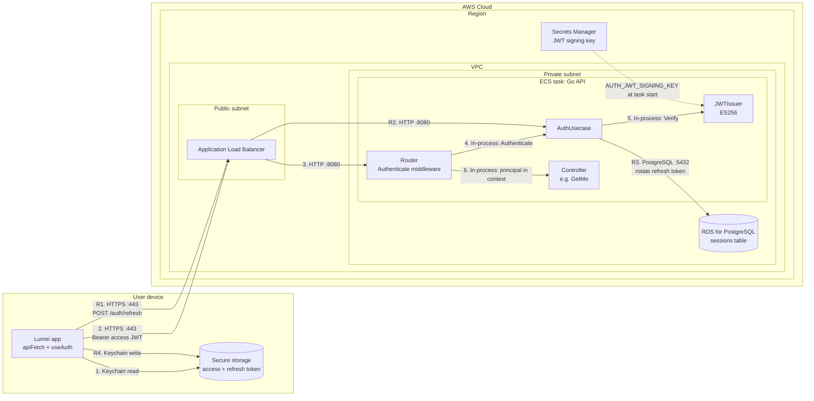

# Authentication

How the mobile app authenticates a call to a signed-in API endpoint, and how it renews its tokens.

- **Stack:** the access token is an ES256 JWT, valid for 15 minutes, that the Go API checks without the database. The refresh token is a random 256-bit value stored hashed in PostgreSQL; it renews the access token and keeps the session alive for 90 days after its last use (BR-ACC-03). The app keeps both tokens in the device's secure storage (iOS Keychain, Android Keystore) through `expo-secure-store`.
- **Scope:** an authenticated request (e.g. `GET /me`) and a token refresh (`POST /auth/refresh`). Signing in with Apple or Google (`POST /auth/sign-in`) and the network layout are out of scope; see [`aws-infrastructure.md`](aws-infrastructure.md).
- **Code paths:**
  - App: `frontend/src/api/client.ts` (`apiFetch`), `frontend/src/auth/store.ts` (`useAuth`), `frontend/src/auth/session-storage.ts`
  - API: `backend/internal/infrastructure/router/auth.go` (`Authenticate` middleware), `backend/internal/application/auth.go` (`AuthUsecase`), `backend/internal/infrastructure/token/jwt.go` (`JWTIssuer`), `backend/internal/infrastructure/database/rdb/repository/session.go`

## Diagram

Solid arrows show calls in order: 1–6 for a request with a valid access token, R1–R4 for a refresh. The dashed arrow shows configuration: the signing key the task reads when it starts.

## Components

| ID         | Resource                         | Placement        | Responsibility |
|------------|----------------------------------|------------------|----------------|
| `app`      | Lumei app: `apiFetch` and `useAuth` | User device   | Adds `Authorization: Bearer <access JWT>` to every API call. Refreshes the token a minute before it expires, or after a 401, then retries once. Concurrent requests share one refresh. |
| `keychain` | Secure storage (`expo-secure-store`) | User device  | Keeps the access token, its expiry, the refresh token, and the user across app restarts (BR-ACC-03) |
| `alb`      | Application Load Balancer        | Public subnet    | Ends TLS and forwards requests to the ECS task (see [`aws-infrastructure.md`](aws-infrastructure.md)) |
| `mw`       | Gin router and `Authenticate` middleware | ECS task | Rejects any request to an operation marked `@useAuth(BearerAuth)` without a valid access token with `401`; public operations pass through |
| `uc`       | `AuthUsecase`                    | ECS task         | Authenticates access tokens; refreshes sessions, rotating the refresh token and ending the session if a replaced one is reused |
| `jwt`      | `JWTIssuer`                      | ECS task         | Signs access JWTs with ES256, and verifies signature, issuer, audience, and expiry against the current or previous signing key |
| `handler`  | Controller, e.g. `GetMe`         | ECS task         | Reads the user only from the principal in the request context, never from the request (BR-ACC-02) |
| `rds`      | RDS for PostgreSQL, `sessions` table | Private subnet | Stores each session's refresh token hash, the replaced token's hash, and the session's expiry |
| `secrets`  | Secrets Manager                  | Regional         | Holds the ES256 private key, injected into the task as `AUTH_JWT_SIGNING_KEY` |

## Connections

| From       | To         | Protocol / Port   | Purpose |
|------------|------------|-------------------|---------|
| `app`      | `keychain` | Keychain read     | Read the access token and its expiry before each call |
| `app`      | `alb`      | HTTPS / 443       | API request with `Authorization: Bearer <access JWT>` |
| `alb`      | `mw`       | HTTP / 8080       | Forward the request to the API |
| `mw`       | `uc`       | In-process        | `Authenticate(accessToken)` |
| `uc`       | `jwt`      | In-process        | `Verify(token, now)`: no database call |
| `mw`       | `handler`  | In-process        | Run the handler with the principal (user and session ID) in the request context |
| `app`      | `alb`      | HTTPS / 443       | `POST /auth/refresh` with the refresh token in the body |
| `alb`      | `uc`       | HTTP / 8080       | The refresh route is public, so the middleware passes it to `RefreshSession` and `AuthUsecase.Refresh` |
| `uc`       | `rds`      | PostgreSQL / 5432 | Find the session by refresh token hash, replace the token, extend the expiry |
| `app`      | `keychain` | Keychain write    | Store the new access and refresh tokens |
| `secrets`  | `jwt`      | Configuration     | Signing key read once at task start |

## Security groups

Authentication adds no network paths. It uses the groups from [`aws-infrastructure.md`](aws-infrastructure.md):

| Security group | Inbound rule            |
|----------------|-------------------------|
| `alb-sg`       | 443 from `0.0.0.0/0`    |
| `ecs-sg`       | 8080 from `alb-sg` only |
| `rds-sg`       | 5432 from `ecs-sg` only |

## Request flow

A call to a signed-in endpoint, e.g. `GET /me`:

1. `apiFetch` asks `useAuth` for an access token. If it expires within 60 seconds, the app refreshes first (steps R1–R4).
2. The app sends the request over HTTPS with `Authorization: Bearer <access JWT>`.
3. The ALB forwards it to the ECS task. The generated route wrapper marks operations declared with `@useAuth(BearerAuth)`.
4. For such an operation, the `Authenticate` middleware passes the token to `AuthUsecase.Authenticate`.
5. `JWTIssuer` checks the ES256 signature with the key named in the token's `kid`, and that `iss` is `lumei-api`, `aud` is `lumei-app`, and `exp` hasn't passed. It doesn't query the database.
6. The middleware puts the principal (user ID and email from the token, and its session ID) in the request context, and the handler answers.

A refresh, before expiry or after a `401`:

- **R1.** The app sends `POST /auth/refresh` with its refresh token. Concurrent requests wait for this one refresh instead of each sending their own.
- **R2.** The route is public, so the request reaches `AuthUsecase.Refresh` without an access token.
- **R3.** `AuthUsecase` finds the session by the token's SHA-256 hash, replaces the refresh token in one conditional `UPDATE`, keeps the old hash, and extends the session to 90 days from now. It then signs a new access JWT.
- **R4.** The app stores the new tokens and sends the original request again, once.

When a step fails:

| Situation | API answer | App behavior |
|-----------|------------|--------------|
| Access JWT missing, invalid, or expired | `401 unauthenticated` (step 5) | Refreshes and retries once |
| Refresh token unknown, or the session expired | `401 unauthenticated` (R3) | Signs the user out on the device |
| Refresh token replaced less than a minute ago, e.g. its response was lost | `200` with new tokens (R3) | Continues normally |
| Refresh token replaced more than a minute ago | `401`, and the session is deleted (R3) | Signs the user out; a copy of the token is assumed stolen |
| No network during a refresh | None | Stays signed in; the request fails as a network error (BR-NFR-05) |

## Assumptions

The requirements didn't specify these, so this document assumes them. Update them when they're decided.

| Item | Assumption |
|------|------------|
| Signing key delivery | Stored in Secrets Manager and injected by the ECS task definition's `secrets` as `AUTH_JWT_SIGNING_KEY`. Local development uses the dev-only key in `backend/.env.dev`. |
| Key rotation | Manual: the new key becomes `AUTH_JWT_SIGNING_KEY` and the old one `AUTH_JWT_PREVIOUS_SIGNING_KEY` for at least 15 minutes, the access token lifetime, so no one is signed out. |

## Not shown in the diagram

- **Sign-in:** `POST /auth/sign-in` exchanges an Apple or Google ID token for the first access and refresh tokens. The API verifies the ID token against the provider's published keys over the NAT gateway (see [`aws-infrastructure.md`](aws-infrastructure.md)).
- **Sign-out:** `POST /auth/sign-out` deletes the session row, so its refresh token stops working at once (BR-ACC-04). The app discards both tokens immediately. A copy of the access JWT made beforehand still works until it expires, at most 15 minutes, because access tokens are checked without the database.
- **Route 53 and AWS WAF:** they sit in front of the ALB for every request, authenticated or not; see [`aws-infrastructure.md`](aws-infrastructure.md).
- **Multiple devices:** each device has its own session and refresh token. Signing out or a reused token ends only that device's session.
