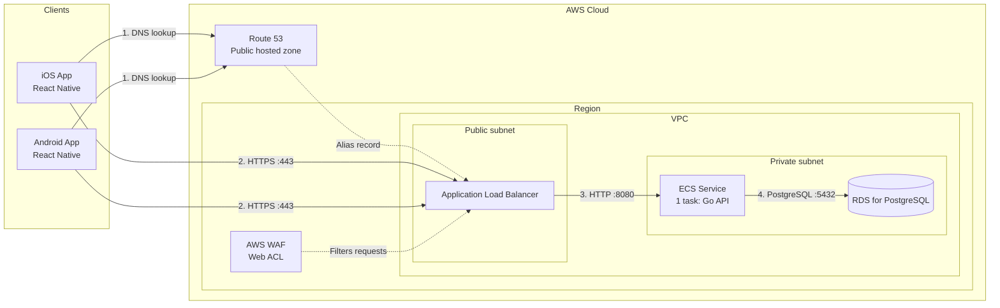

# AWS Infrastructure

How the AWS infrastructure is laid out and how a request travels from a mobile app to the database.

- **Stack:** React Native mobile app (one codebase for iOS and Android) a Go backend API, and PostgreSQL on Amazon RDS.
- **Scope:** network layout, AWS resources, and traffic between them. Application internals are out of scope.
- **Code paths:** `infra/` (AWS resources), `frontend/` (React Native app), `backend/` (Go API)

## Diagram

Solid arrows show traffic. Dashed arrows show configuration links (a DNS alias, a WAF association).

## Components

| ID        | Resource                  | Placement      | Responsibility                                              |
|-----------|---------------------------|----------------|-------------------------------------------------------------|
| `ios`     | iOS app (React Native)    | User device    | Calls the backend API over HTTPS; built from `frontend/`    |
| `android` | Android app (React Native) | User device   | Calls the backend API over HTTPS; built from `frontend/`    |
| `r53`     | Route 53 public hosted zone | Global       | Resolves the API domain to the ALB with an alias record     |
| `waf`     | AWS WAF web ACL           | Regional       | Attached to `alb`; blocks malicious or unwanted requests    |
| `alb`     | Application Load Balancer | Public subnet  | Ends TLS and forwards requests to the ECS target group      |
| `ecs`     | ECS service (1 task)      | Private subnet | Runs the Go API container built from `backend/`             |
| `rds`     | RDS for PostgreSQL        | Private subnet | Main relational database                                    |

## Connections

| From              | To    | Protocol / Port | Purpose                                  |
|-------------------|-------|-----------------|------------------------------------------|
| `ios`, `android`  | `r53` | DNS             | Look up the API domain                   |
| `ios`, `android`  | `alb` | HTTPS / 443     | API requests                             |
| `waf`             | `alb` | Association     | Check each request before the ALB routes it |
| `alb`             | `ecs` | HTTP / 8080     | Forward requests to the target group     |
| `ecs`             | `rds` | PostgreSQL / 5432 | Database queries                       |

## Security groups

| Security group | Inbound rule                     |
|----------------|----------------------------------|
| `alb-sg`       | 443 from `0.0.0.0/0`             |
| `ecs-sg`       | 8080 from `alb-sg` only          |
| `rds-sg`       | 5432 from `ecs-sg` only          |

Only the ALB can be reached from the internet. The ECS task and RDS instance have no public IP addresses.

## Request flow

1. The mobile app looks up the API domain in Route 53 and gets the ALB's address.
2. The app sends an HTTPS request to the ALB. AWS WAF checks it first; blocked requests get `403`.
3. The ALB ends TLS and forwards the request to the ECS task.
4. The ECS task queries RDS and sends the response back through the ALB.

## Assumptions

The requirements didn't specify these, so this document assumes them. Update them when they're decided.

| Item                | Assumption                                                       |
|---------------------|------------------------------------------------------------------|
| ECS launch type     | Fargate                                                          |
| Container port      | 8080 (the Go HTTP server listens here)                           |
| TLS certificate     | Issued by ACM and attached to the ALB HTTPS listener             |

## Not shown in the diagram

- **Multiple AZs:** an ALB needs subnets in at least two Availability Zones, and an RDS DB subnet group needs subnets in at least two AZs. The diagram shows one logical public subnet and one logical private subnet to keep it simple.
- **Outbound access from the private subnet:** the ECS task needs a NAT gateway or VPC endpoints (ECR, S3, CloudWatch Logs, Secrets Manager) to pull images, write logs, and read secrets.
- **Supporting services:** ECR, CloudWatch Logs, Secrets Manager (database credentials), and IAM roles for the task.
