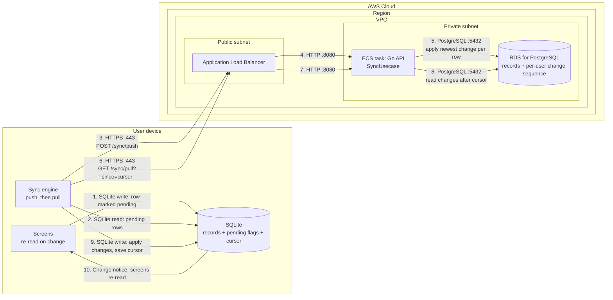

# Offline Sync

How the mobile app saves changes on the device first and syncs them with the Go API, so the app works offline (BR-OFF-01 to BR-OFF-06, BR-NFR-04, BR-NFR-05).

- **Status:** implemented: the on-device database (`frontend/src/db/`), the sync engine (`frontend/src/sync/`), and the two sync endpoints with their PostgreSQL tables. Screens update after every write through a change notifier (`frontend/src/db/changes.ts`) rather than SQLite live queries, and the engine's writes go through it too. Not implemented yet: the two category rules in [Conflict rules](#conflict-rules) (BR-CAT-04, BR-CAT-05), which come with the category screens, since nothing can create or delete a category before then.
- **Stack:** the app keeps every record in SQLite on the device (`expo-sqlite` with Drizzle). Screens read and write only that database. A sync engine in the app pushes local changes to the API and pulls changes from other devices. The API stores the records in PostgreSQL on RDS and resolves conflicts. The sync protocol is our own: two endpoints, no third-party sync service.
- **Scope:** all user data: settings, categories, periods, income, fixed expenses, targets, and expenses. Each one uses the same mechanism, so BR-OFF-06 comes with BR-OFF-01. Signing in, account deletion, and the network layout are out of scope; see [`authentication.md`](authentication.md) and [`aws-infrastructure.md`](aws-infrastructure.md).
- **Code paths:**
  - App: `frontend/src/db/` (schema, client, queries; migrations in `frontend/drizzle/`), `frontend/src/sync/` (`engine.ts` runs a cycle, `scheduler.ts` decides when, `rows.ts` converts rows), `frontend/src/domain/sync.ts` (the conflict rules)
  - API: `backend/api/typespec/sync.tsp`, `backend/internal/application/sync.go` (validation and conflict rules), `backend/internal/interface/controller/sync.go`, `backend/internal/infrastructure/database/rdb/repository/sync.go`, `backend/migration/20261105141028_create_synced_records.up.sql`

## Diagram

Solid arrows show calls in order: 1 is the user's change, which never waits for the network; 2–5 push it; 6–9 pull other devices' changes; 10 updates the screens. There are no configuration links.

## Components

| ID       | Resource                       | Placement      | Responsibility |
|----------|--------------------------------|----------------|----------------|
| `ui`     | Screens (React Native)         | User device    | Write records to SQLite and read them again after every change notice, so a saved expense shows on the home screen within a second, online or offline (BR-NFR-04). Never call the sync endpoints. |
| `sqlite` | SQLite database (`expo-sqlite`) | User device   | The app's only source of data. One database file per signed-in account. Holds the records, which rows haven't synced (BR-OFF-04), and the pull cursor. |
| `engine` | Sync engine (`src/sync/`)      | User device    | Runs a sync cycle (push, then pull) when it is triggered. Only one cycle runs at a time. |
| `alb`    | Application Load Balancer      | Public subnet  | Ends TLS and forwards requests to the ECS task (see [`aws-infrastructure.md`](aws-infrastructure.md)) |
| `api`    | Go API: `SyncUsecase`          | Private subnet | Authenticates the request (see [`authentication.md`](authentication.md)), validates each pushed row, applies the conflict rules, and returns changes after a cursor. Scopes every query to the signed-in user (BR-ACC-02). |
| `rds`    | RDS for PostgreSQL             | Private subnet | Stores every record with its sync columns, and each user's change counter |

## Connections

| From     | To       | Protocol / Port   | Purpose |
|----------|----------|-------------------|---------|
| `ui`     | `sqlite` | In-process (SQLite) | Save the user's change and mark the row pending, in one transaction |
| `engine` | `sqlite` | In-process (SQLite) | Read the pending rows, in batches |
| `engine` | `alb`    | HTTPS / 443       | `POST /sync/push` with the pending rows |
| `alb`    | `api`    | HTTP / 8080       | Forward the push |
| `api`    | `rds`    | PostgreSQL / 5432 | Apply each row that wins its conflict, in one transaction per request |
| `engine` | `alb`    | HTTPS / 443       | `GET /sync/pull?since=<cursor>` |
| `alb`    | `api`    | HTTP / 8080       | Forward the pull |
| `api`    | `rds`    | PostgreSQL / 5432 | Read the user's rows changed after the cursor, oldest first |
| `engine` | `sqlite` | In-process (SQLite) | Apply the pulled rows and save the new cursor, in one transaction |
| `sqlite` | `ui`     | In-process (change notice) | Re-render the screens showing records, which read them again |

## Security groups

Sync adds no network paths. It uses the groups from [`aws-infrastructure.md`](aws-infrastructure.md):

| Security group | Inbound rule            |
|----------------|-------------------------|
| `alb-sg`       | 443 from `0.0.0.0/0`    |
| `ecs-sg`       | 8080 from `alb-sg` only |
| `rds-sg`       | 5432 from `ecs-sg` only |

## Request flow

### Sync columns

Every synced table, on the device and in PostgreSQL, has these columns. They are what make the rules below work.

| Column | Where | Meaning |
|--------|-------|---------|
| `id` | Both | A UUIDv7 the device creates when the record is created. A change made offline already has its final ID, so pushing it twice can't create two records (BR-OFF-03). |
| `updated_at` | Both | When the user made the change, by the device's clock, in milliseconds (UTC). It decides which change wins (BR-OFF-05). |
| `deleted_at` | Both | Set when the user deletes the record. The row stays as a marker (a tombstone), so other devices learn of the deletion and "delete beats edit" works. Screens hide these rows. Tombstones are kept for the life of the account, so a device offline for months still learns of deletions; account deletion (BR-ACC-05) removes them. |
| `pending` | Device | True while the row has a change the API hasn't confirmed. The app shows these as not synced yet (BR-OFF-04). |
| `local_rev` | Device | Increases with every local change, so a confirmation for an older version of the row doesn't clear a newer edit. |
| `sync_error` | Device | Why the API rejected the row's latest change (e.g. `invalid_row`), or null. A rejected row stays pending but isn't pushed again until the user changes it, which clears this. |
| `user_id` | API | The owner, always taken from the access token, never from the request (BR-ACC-02) |
| `change_seq` | API | The user's change counter at the time this row last changed. Pulls return rows in this order. |

The device also stores the **cursor**, the highest `change_seq` it has pulled, in its one-row `sync_state` table, which isn't synced. The API keeps each user's change counter in `sync_state` too: one row per user, which a push locks.

Some records must get the same ID on every device, so two devices that create them offline end up with one record, not two:

| Record | ID |
|--------|----|
| Settings (one row per user) | The user ID |
| Default categories created at setup (BR-CAT-01) | A UUIDv5 of the user ID and the seed category's key |
| A period, created at setup or automatically (BR-PER-03) | A UUIDv5 of the user ID and the period's start date |
| The saving target of a period (one per period, BR-TGT-01) | A UUIDv5 of the period's ID |
| An income or fixed expense copied into a new period (BR-PER-03) | A UUIDv5 of the new period's ID and the copied item's ID |

### When a sync runs

The engine starts a cycle when the app opens or returns to the foreground, 3 seconds after the user's change (so a burst of changes goes in one push), when the network comes back, and every minute while the app is open. A request while a cycle runs starts one more cycle right after it. The engine's own writes don't start a cycle. Without a network, the engine stops quietly and the app keeps working (BR-NFR-05).

Syncing runs only while the app is open (BR-OFF-03). There is no background sync in the first release; changes made offline sync the next time the app opens online.

### Push (arrows 2–5)

1. The engine reads up to 200 pending rows the API hasn't rejected, oldest change first, with each row's `local_rev`.
2. It sends `POST /sync/push` with the rows. Each row is sent whole: all its fields plus its sync columns, not just the fields that changed.
3. The API locks the user's change counter for the rest of the transaction. That puts concurrent pushes from the user's devices in order, so pulls never skip a change.
4. For each row, the API validates it (types, amounts as minor-unit integers, the record belongs to the user, and an `updated_at` at most 5 minutes ahead of the API's clock) and applies the conflict rules below. A row that wins is stored with the next `change_seq`.
5. The API answers with each row's outcome:
   - `applied`: the API now has this change.
   - `superseded`: the API already has a newer change, or a deletion. The next pull brings it.
   - `rejected`: the row is invalid, with an error code.
6. For each `applied` or `superseded` row whose `local_rev` hasn't changed since step 1, the engine clears `pending`. For each `rejected` one, it saves the error code in `sync_error`. A row edited during the push stays pending and goes in the next push.
7. The engine repeats until no pending rows are left, then pulls.

Pushing the same rows again is harmless: a row that's already applied has the same `updated_at`, so it comes back `superseded` and changes nothing. That is how a change is never applied twice, even when a response is lost (BR-OFF-03).

### Pull (arrows 6–9)

1. The engine sends `GET /sync/pull?since=<cursor>`.
2. The API returns up to 500 of the user's rows with a `change_seq` above the cursor, oldest first, deleted rows included. It also returns the new cursor and whether more rows are waiting.
3. In one SQLite transaction, the engine writes each row:
   - A row that isn't pending on the device is overwritten.
   - A row that is pending goes through the same conflict rules as on the API. If the pulled version wins, it overwrites the local one and clears `pending`. If the local change wins, it stays pending, and the next push sends it.
4. The engine saves the new cursor in the same transaction, then pulls again while more rows are waiting.
5. A change notice makes every screen showing records read them again (arrow 10).

A device that signs in for the first time starts with cursor 0 and so pulls everything. It does this before deciding whether the user needs setup, so a user who finished setup on another device goes straight to the home screen (BR-ACC-06). A pulled row of a table the app version doesn't have is skipped.

### Conflict rules

The API and the device apply the same rules, so they always agree on which change wins:

1. **A deletion wins over any edit,** whenever either was made (BR-OFF-05). A deleted row is never changed back.
2. **Otherwise the most recent change wins:** the one with the later `updated_at`, which is when the user made the change by the device's clock, not when it reached the API (BR-OFF-05). The whole row wins, not single fields. A device whose clock is wrong can still win when it shouldn't, but only by up to 5 minutes: a row dated further ahead than that is `rejected`.
3. **On a tie, the version the API already has wins,** so pushing again never changes the result.

Some rules come from requirements, not timestamps:

| Situation | What happens |
|-----------|--------------|
| A push changes the account currency (BR-SET-04) | That row is `rejected` |
| A row's `updated_at` is more than 5 minutes ahead of the API's clock (BR-OFF-05) | That row is `rejected` |
| Two devices create a category with the same name offline (BR-CAT-04) | The API keeps the first one it receives and adds a number to the later one's name, e.g. "Coffee (2)". The renamed row is stored as a new change, so every device pulls the new name. |
| An expense uses a category that another device deleted (BR-CAT-05) | The API archives the category instead of deleting it (BR-CAT-03), so the expense keeps its category. The archived row is stored as a new change, so the deleting device pulls it back. |

### When a step fails

| Situation | What the app does |
|-----------|-------------------|
| No network, or the API can't be reached | Stops the cycle and keeps the rows pending. The app keeps working offline (BR-NFR-05). |
| The response is lost after the API applied the push | Pushes the same rows again in the next cycle. They come back `superseded` (BR-OFF-03). |
| The API answers `401` | Refreshes the access token and retries once, as for any request (see [`authentication.md`](authentication.md)). If the session has ended, the user is signed out. |
| A row is `rejected` | Keeps it pending with its error in `sync_error`, doesn't push it again until the user changes it, and marks it "couldn't sync" on the home screen and in the account screen (BR-OFF-04). The app validates input before saving, so this should only happen in rare cases such as a change from an outdated app version. |
| A new device can't download the account's data (BR-ACC-06) | Says so and offers to try again, rather than starting setup, which would clash with the account's data on the server. |
| The user signs out with pending rows (BR-ACC-04) | Pushes first. If the push fails, warns that the unsynced changes will be lost and lets the user cancel. Signing out then deletes the account's database file on the device. |
| The app is closed during a cycle | Nothing is lost. A row stops being pending only after the API confirmed it, and the cursor moves only together with the rows it covers. |

## Assumptions

None at the moment. Add new rows as `| Item | Assumption |`.

## Not shown in the diagram

- **Authentication:** every sync request carries the access JWT, checked by the `Authenticate` middleware before `SyncUsecase` runs; see [`authentication.md`](authentication.md).
- **Route 53, AWS WAF, and multiple AZs:** they sit in front of the ALB, or under every resource, for all requests; see [`aws-infrastructure.md`](aws-infrastructure.md).
- **Several devices:** the diagram shows one. Every device runs the same cycle against the same API. The per-user lock in step 3 of Push puts their pushes in order.
- **Network monitoring:** the engine listens for the device coming back online to start a cycle; that is a device API, not a connection to AWS.
- **Database migrations:** the device migrates its SQLite schema when the app starts, before the first sync. The API migrates PostgreSQL with `make migrate-up`. A new column is added to both before any app version sends it.
- **Account deletion (BR-ACC-05):** deleting the account removes the user's rows from RDS. Other signed-in devices then fail to refresh their session, sign out, and delete their local database.
